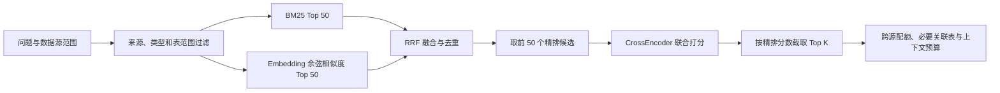

# Recall 混合检索与重排方案

Recall 使用 BM25 和 embedding 两路召回，以 RRF 合并候选，再由本地重排模型联合阅读问题和候选文本，输出精细相关性分数。表结构、知识和训练案例共用检索实现，各自检索，不混合不同类型的排名。

默认接入共享 models 目录中的 Qwen3-Embedding-8B 和 Qwen3-Reranker-8B。真实模型测试需显式启用，GPU 离线比较入口见文末；下文参数是实现默认值，不代表经过调优的最优配置。

## 流程



1. 先按 schema、knowledge、example 类型，数据源集合、候选表范围、排除来源和已确认关联等条件过滤。过滤后的候选才参与两路排名，避免无效来源占用召回名额。
2. BM25 使用已有 rank-bm25.BM25Okapi；中文按 1–3 字 n-gram，英文保留字段标识符。只保留正分文档的前 recall_bm25_top_k 条。
3. Embedding 使用 SentenceTransformer，问题添加检索任务指令，文档使用空 prompt。向量 L2 归一化，以 FAISS IndexFlatIP 或 NumPy 点积计算余弦相似度，保留前 recall_embedding_top_k 条。问题和文档使用不同缓存键，避免同文本但不同 prompt 的向量混用。
4. 两路结果按 source_id 对齐，按从 1 开始的名次计算 `RRF(d) = Σ 1 / (rrf_k + rank_channel(d))`，默认 rrf_k=60。文档只在一路出现时仅计该路分数；不相加 BM25 原始分和余弦相似度。
5. 对 RRF 候选排序，取前 max(最终 K, recall_rerank_top_k) 条送入本地 CrossEncoder；候选不足则全部使用。不把未评分的尾部候选混入最终结果。
6. 最终按 rerank_score 降序；同分时按候选分和 source_id 稳定排序。分数是原始相关性 logits，不作为概率，也不与 RRF 分数直接相加。未召回的候选不会被重排补出。

两路召回深度是候选上限；需要更大的最终 K 时，应相应提高召回深度。代码不通过扩大模型输出值或降低预处理关联阈值来补齐候选。

## 表、知识和案例的衔接

- 表召回先得到较宽的 Schema 候选，再根据相关知识支持加入候选或提供 `0.25 / (rrf_k + knowledge_table_rank)` 的候选优先分，最后统一精排。知识分数只用于候选排序，不能改变目录中的 table–knowledge 关系。
- 知识召回合并表检索携带的知识和直接召回知识，去重后统一精排，再保留默认最多 12 条。当前表支持知识仍要求稀有词锚点；没有目录关联的知识不会因重排自动获得关联。
- 训练案例同样使用 BM25 + embedding + RRF + 重排，索引文本为训练问题，不把验证答案或测试答案作为候选文本。跨系统问题保留系统配额，常规上下文默认最多 4 个案例。
- 跨系统表候选保留原有轮取配额和最多 2 个一跳声明外键邻表名额。邻表属于结构性补充，以 reason 标明，不伪称经过模型打分。开启精排后，不再用首个训练案例强行替换精排选中的表。
- 预算裁剪仍整条移除证据，保留原始知识全文和来源。不会为了精排改写知识、补业务解释或把候选关系升级为确认关系。

## 实现位置

| 文件 | 职责 |
| --- | --- |
| src/text2query/retrieval/index.py | 两路 Top K、RRF、来源过滤、候选合并和统一精排 |
| src/text2query/retrieval/ranking.py | RecallConfig 与延迟加载的 RerankerService |
| src/text2query/retrieval/embedding.py | 检索编码器工厂，区分问题和文档 prompt |
| src/text2query/routing/embedding.py | 本地 embedding 加载、向量归一化及角色隔离缓存 |
| src/text2query/retrieval/context.py | 跨源配额、证据组装与预算裁剪 |
| src/text2query/submission/finetuned.py | 微调入口使用同一召回实现 |

RerankerService 复用 sentence-transformers 5.4+ 的 CrossEncoder，Qwen causal LM 的模板及 yes/no logits 适配交给社区库，不自行维护模型评分算法。依赖约束为 sentence-transformers>=5.4.0,<6.0 和 transformers>=4.51.0,<6.0。

## 本地权重路径与参数

复制 .env.example 到本地 .env 后可配置以下参数；也可直接提供 T2Q_ 环境变量。默认相对路径以 V6 仓库根目录解析。

| 配置 | 默认值 | 用途 |
| --- | --- | --- |
| T2Q_EMBEDDING_MODEL | ../models/Qwen3-Embedding-8B | 共享 embedding 完整模型目录 |
| T2Q_RERANKER_MODEL | ../models/Qwen3-Reranker-8B | 共享重排完整模型目录 |
| T2Q_RECALL_BM25_TOP_K | 50 | BM25 每路候选上限 |
| T2Q_RECALL_EMBEDDING_TOP_K | 50 | 向量每路候选上限 |
| T2Q_RECALL_RRF_K | 60 | RRF 平滑常数 |
| T2Q_RECALL_RERANK_TOP_K | 50 | 精排候选数，至少容纳最终 K |
| T2Q_RECALL_RERANK_ENABLED | true | 是否执行精排 |
| T2Q_RERANKER_DEVICE | cpu | 重排推理设备，可改为 cuda 或 auto |
| T2Q_RERANKER_DTYPE | auto | CPU 默认 float32，其他设备默认 float16 |
| T2Q_RERANKER_BATCH_SIZE | 8 | 精排批大小 |
| T2Q_RERANKER_MAX_LENGTH | 2048 | 精排模型输入 token 上限 |
| T2Q_RERANKER_INSTRUCTION | 代码中的数据库检索指令 | 可覆盖模型任务说明 |

模型目录需要包含完整权重、config、tokenizer、模板及模型附带配置；只创建空目录不足以推理。两个服务均 local_files_only=True，延迟加载权重，不自动联网下载。缺失或无效权重直接报错；不会把“没有模型”伪装成已完成精排。部署时可用绝对路径覆盖默认占位路径。

Embedding 输入长度由 build-index、recall/retrieve、plan 的 --max-length 控制，CLI 默认 512；构建和加载索引时编码器的模型、指令、设备、精度、输入长度必须一致。重排长度只限制模型输入，最终返回的知识原文仍完整。

## 接入入口

- `text2query recall` 是 `text2query retrieve` 的等价命令；默认使用完整混合检索与重排。
- `plan` 和常规提交生成共用 RetrievalIndex，因此也使用相同评分链。
- `finetuned-submission --recall hybrid` 为新的默认值；schema 是这一上下文召回模式的兼容名称。`--recall examples` 只通过案例选表，但案例也已使用完整混合检索与精排，不再仅比较向量相似度。
- `--keyword-only` 是明确选择 BM25 的诊断模式，不加载 embedding 和重排。`T2Q_RECALL_RERANK_ENABLED=false` 可保留 BM25 + embedding + RRF，只关闭精排。
- 历史 SQLite/提交实验明确以 encoder=None 创建的索引继续是关键词实验，不能当成完整混合检索实验。

以下仅是权重到位后的使用示例，本次未执行：

```bash
text2query build-index --device cpu --dtype float32
text2query recall --device cpu --dtype float32 --engines MYSQL --question '统计各公司驾驶员中女性驾驶员的比例'
```

微调入口使用全量训练索引，需提前构建对应目录：

```bash
text2query build-index --index outputs/information_retrieval/index_full_train --training-source data/赛题8/QA_train.json
text2query finetuned-submission --recall hybrid --prepare-only
```

## 来源与版本

每个检索命中保存 source_id、table_ids、keyword_score/rank、semantic_similarity/rank、rrf_score/rank、candidate_score、rerank_score/rank 及 ranking_method。表、知识和案例的上下文保留对应检索依据；结构性邻表补充只记录实际来源。

索引版本升至 4。索引 manifest 记录构建时的 Recall 配置、模型路径/参数及权重文件元信息；加载时继续验证输入文件、向量对齐和编码器签名。问题/文档编码方式已经变化，旧索引必须重建。仅调整 RRF 或重排设置不改变文档向量，允许在同一索引上做后续对照；运行时 Recall 配置与模型签名可从 index.recall_metadata 取得，微调 prepare-only 结果会保存该配置。

原有预处理、知识关联和冻结评价基准保持独立。表结构→知识实验衡量候选排序；逐题任务仍需分别评估初始候选覆盖、Recall@K、预算裁剪后的多表完整召回率、无关证据量、最终查询正确率和延迟。

## 已接入的 8B 模型与待运行测试

当前使用仓库根目录旁的共享 models 目录，模型修订固定为：

- Qwen3-Embedding-8B：1d8ad4ca9b3dd8059ad90a75d4983776a23d44af。
- Qwen3-Reranker-8B：77d193c791ed757ca307ee72715aa132723da912。

LFS 权重和 tokenizer 的大小与 SHA256 记录在 [model_weights_manifest.json](model_weights_manifest.json)。该记录来自克隆版本的 Git LFS 指针，模型目录相对 V6 根目录解析，可用于下载完成后的完整性核对。

`scripts/verify_model_weights.py` 只核对下载文件，不加载模型。核对记录可写入共享目录的 download-verification.json，与后续模型测试及检索效果报告分开保存。

`tests/test_local_models.py` 已引用 Settings 中的实际模型路径。测试默认跳过，只有在进程环境显式设置 T2Q_RUN_MODEL_TESTS=1 时才加载权重。它将编码与重排分阶段执行，embedding 文档和问题向量缓存后释放 embedding 模型，再加载重排模型，避免两个 8B 模型同时驻留。

当前本机未检测到可用 GPU，物理内存约 30 GiB，因此按用户最新要求不执行测试。后续具备 GPU 条件后，可显式运行以下命令；本次未执行：

```bash
T2Q_RUN_MODEL_TESTS=1 T2Q_MODEL_TEST_DEVICE=cuda T2Q_MODEL_TEST_DTYPE=float16 python -m pytest tests/test_local_models.py -m model
```

人工＋LLM 的 reference-v1 标注对象为旧版 247 条知识、72 张表及 270 个接受配对。当前 knowledge.json 已变为 1833 条，其中有 73 条同 ID 改写，旧标注不能直接作为新版全量真值。后续对比需保留原基准，分别报告旧版完整基准的复现结果和新版中原文未变化条目的可比结果，新增或改写知识单独列为待标注。该 table–knowledge 基准与逐题召回标签不同，不能互相替代或混报成绩。

### GPU 离线比较入口

BF16/FP16 推理返回的向量转为 float32 后再次执行 L2 归一化，再写入缓存和向量索引。
缓存签名包含 `normalization_dtype=float32`，旧缓存不会与此协议混用。

`evaluation/table_knowledge/evaluate_hybrid_recall.py` 使用冻结输入中的原始 Schema 构造72个表查询，
对 BM25、Embedding、RRF、RRF＋重排做相同候选范围的比较。两路各取50，RRF k=60，重排前50，
报告不同 K 下的 precision、recall、F1、MRR、nDCG 以及逐表差异。

```bash
python evaluation/table_knowledge/evaluate_hybrid_recall.py \
  --output-dir evaluation/table_knowledge/runs/hybrid-qwen3-8b-gpu-v1 \
  --device cuda:0 --dtype bfloat16 \
  --embedding-batch-size 4 --reranker-batch-size 2
```

输出目录必须不存在。默认两个模型同时保留；24GB 显存的分阶段评估需加 `--release-embedding`。
两个语料的所有排序完成后才读取审核标签。旧247条按270个接受配对评分；
新版1833条只对 ID 与原文同时未变的173条知识、155个接受配对评分。
改写与新增知识的返回数单列为未标注，不计为多关联；新版 precision/F1 的分母仅含已标注返回，
需同时查看 `judged_fraction`，不能把这些指标当成新版全量精度。

此入口是表结构→知识的候选排序实验，尚需逐题召回标注才能评估实际问题的召回率。
Top-K 返回不写回预处理关联，不读取训练、验证或测试问答，也不调用外部 LLM。

官方接口依据：[CrossEncoder 5.4.0](https://github.com/huggingface/sentence-transformers/blob/v5.4.0/sentence_transformers/cross_encoder/model.py)、[Retrieve & Re-Rank](https://www.sbert.net/examples/sentence_transformer/applications/retrieve_rerank/README.html)、[Qwen3 模型说明](https://github.com/QwenLM/Qwen3-Embedding)。
