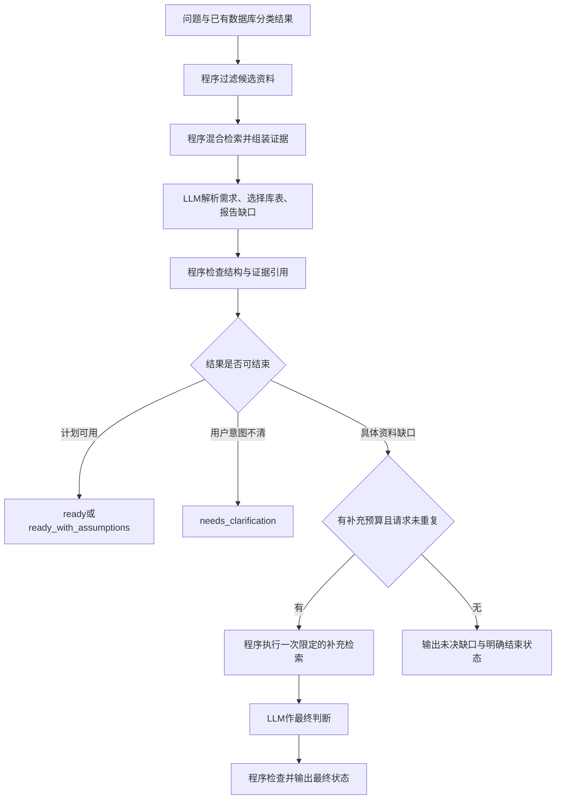

# 库表信息召回设计说明

日期：2026-10-11。本文描述分类之后、查询指令生成之前的信息召回流程，是待实现的设计，不代表召回模块已经实现。

## 1. 目标与边界

输入用户问题和已有数据库分类结果，召回相关业务库、表、字段、知识及训练案例，由 LLM 形成有依据的库表选择计划。

输出应回答：

- 需要哪些数据库系统和业务库？
- 使用哪些表、字段，以及哪些关联路径？
- 哪些解释有直接证据，哪些依赖推断或假设？
- 是否具备生成查询指令的条件？

本模块不执行业务 SQL，也不保证查询结果。后续模块根据确认的计划生成各数据库对应的查询指令。

本项目的单类／多类按涉及的数据库系统集合判断。同一 MYSQL 或 SQLite 系统内涉及多个业务库、表，仍为单类。

## 2. 职责分工

程序负责可重复、结构化、有明确规则的工作；LLM 负责业务判断和动态解释。

| 程序负责 | LLM 负责 |
|---|---|
| 按 engine 过滤资料 | 理解问题中的实体、属性、条件和统计要求 |
| 计算 embedding 相似度、关键词匹配及排序 | 判断候选表是否满足问题需求 |
| 根据标识读取 schema、知识和案例 | 解释字段含义及问题歧义 |
| 检查表名、字段名、证据编号是否存在 | 判断关联路径是否符合当前业务意图 |
| 整理已声明外键、已记录的关联证据 | 提出具体的信息缺口和检索请求 |
| 控制检索次数、资料数量、上下文预算 | 判断是否能够采用明确的假设继续 |
| 检测重复请求、重复资料和无新增证据 | 给出最终状态、计划及未决问题 |

程序不把相似度当成业务正确性，不根据字段同名自动确认关联，也不因缺少外键就否定关联。

外键存在只能证明结构上有这条路径，不能证明它符合当前问题。例如订单关联购买者和销售人员，两条路径都存在，但回答“谁购买了商品”需要 LLM 选择正确角色。

## 3. 可用资料与索引

现有预处理产物位于 `data/preprocessed`：

| 文件 | 在召回中的用途 |
|---|---|
| schema_catalog.json | 读取完整表／索引结构、字段、类型、约束和来源 |
| schema_documents.jsonl | 按表／索引进行语义及关键词检索 |
| schema_extracted.json | 对照原始提取内容及相关来源资料 |
| manual_review.json | 初次复核结论 |
| secondary_review.json | 二次复核、推断标记及特殊情况 |

知识和案例需要另建检索索引，条目保留稳定标识及与业务库、表的关联。案例仅使用 `data/赛题8/splits/train.json`，不使用验证集或测试集答案。

注意：现有 catalog 每张表最多附带四条训练案例，这不是完整案例索引。正式实现应从全部训练子集建立案例索引，避免把这四条当作所有可用证据。

推荐保留以下元信息：

```text
表／索引：table_id、engine、database、schema、name
字段：name、data_type、description、描述来源、复核状态
知识：knowledge_id、原文、涉及的库表字段
案例：question_id、数据库系统集合、问题、查询指令、涉及的库表
证据：source_id、来源位置、直接声明／案例支持／推断
```

索引必须绑定 schema 和描述版本。资料发生变化时更新对应索引，不能继续使用旧向量却读取新结构。

## 4. 整体流程与调用次数

第一版不要求前置调用 LLM 拆分问题。直接用原问题召回，再让一次 LLM 调用同时完成需求解析、库表选择和缺口判断。



首轮检索是本地索引操作，不是一次 LLM 调用，更不是业务数据库查询。常规问题只需一次 LLM 判断；有可补充资料的具体缺口时，最多增加一次判断。

若后续发现复杂问题直接召回效果不足，可以增加前置 LLM 需求拆分，但应通过评估确认收益，而不是默认增加调用。

## 5. 首轮候选范围

程序按分类结果过滤表级索引，以及对应知识和案例的候选范围。

例如分类为 SQLite：

```python
candidate_tables = [
    table for table in schema_catalog["tables"]
    if table["engine"] == "SQLite"
]
```

分类为 MYSQL＋POSTGRESQL 时，保留两种系统的资料。各系统分别召回并保留一定配额，避免某一种系统的高相似结果占满全部候选。

案例优先级：

- 单类问题：优先相同系统的单库案例。
- 多类问题：优先相同系统组合的跨库案例，并补充每个系统的相关单库案例。

这一步建立可检索范围，不把整个 schema 文件或所有案例直接发送给 LLM。分类结果是初始范围，不是不可更改的事实；后续发现具体覆盖缺口时，可有界扩展系统范围。

## 6. 混合召回与证据组装

### 6.1 表级召回

同时执行：

1. embedding 检索：原问题与表级描述、字段解释的语义匹配。
2. 关键词检索：库名、表名、字段名、业务描述中的词项匹配。

可以先采用倒数排名融合（RRF）等固定规则合并两路结果。其用途是排序候选，不是证明候选正确。

原问题直接出现 `vessel_type=70`、`max_load` 等技术名称时，关键词结果有助于保留精确字段匹配。中文“最大载重”“出生年份”等表达则同时依赖字段描述及语义检索。

### 6.2 读取候选资料

按召回的 table_id 读取：

- 完整表结构及字段列表，初期以表为最小 schema 单位。
- 已声明外键及其直接关联目标的必要信息。
- 与问题和候选表相关的知识条目。
- 相似训练案例及其查询指令。
- 描述推断标记、来源冲突和二次复核注意事项。

关联表的补充同样占用候选和上下文预算，不能无限递归展开外键。第一版最多展开一层；更长路径由 LLM 提出具体请求。

所有资料保留来源标识。资料去重后再组装上下文，避免同一 schema 或案例重复消耗预算。

### 6.3 上下文包

```json
{
  "question_id": 5635,
  "initial_databases": ["SQLite"],
  "candidate_tables": [
    {
      "table_id": "SQLite:hockey.Master",
      "retrieval_evidence": {
        "semantic_rank": 1,
        "keyword_hits": ["出生国家", "出生年份"]
      },
      "schema": "完整表结构",
      "knowledge_ids": [834, 837],
      "example_ids": [5635],
      "review_notes": []
    }
  ],
  "retrieval_budget": {
    "remaining_expansion_rounds": 1
  }
}
```

排名仅为格式示意，实际值必须由检索程序产生。

## 7. LLM的判断输出

LLM 接收原问题、候选资料和剩余预算，完成：

- 解析业务需求。
- 选择表和字段，解释选择依据。
- 判断是否需要关联，以及关联是否符合业务意图。
- 识别问题歧义、资料冲突和字段覆盖缺口。
- 输出可继续的计划，或提出具体补充请求。

不能只返回“信息不够”。补充请求应说明缺什么、已经检查什么、期望程序提供哪类资料。

```json
{
  "status": "need_more_evidence",
  "selected_tables": [],
  "gaps": [
    {
      "kind": "missing_attribute",
      "requirement": "最大载重",
      "checked_tables": ["POSTGRESQL:public.vessel_ais_data"],
      "requested_evidence": "包含船舶最大载重属性的表结构",
      "search_query": "船舶静态资料 最大载重",
      "allow_engine_expansion": true
    }
  ]
}
```

结构检查包括表字段是否存在、证据编号是否有效、输出是否符合协议。业务需求是否完整覆盖以及关联是否合理，仍由 LLM 判断；程序不把字段存在等同于业务覆盖完成。

## 8. 有界补充检索

不同缺口采用不同动作：

| 缺口 | 程序动作 | 不应执行的动作 |
|---|---|---|
| 缺少属性 | 按明确属性补检索，必要时扩大系统范围 | 重新发送整个 schema |
| 关联方式不清 | 读取对应外键、已复核关系和关联案例 | 根据同名字段自动建立外键 |
| 描述冲突 | 提供对应来源原文和复核记录 | 任意选一种描述并隐藏冲突 |
| 用户意图模糊 | 输出待澄清解释，或由LLM提出显式假设 | 不断增加表以替代意图澄清 |
| 实际值域未知 | 有工具能力时进行另行设计的限定探查，否则结束并注明 | 编造取值、单位或日期编码 |

第一版可采用以下配置起点，后续根据验证集调整：

```text
首轮候选表：最多8张
补充轮数：最多1轮
新增表：最多4张
累计候选表：最多12张
知识：首轮最多12条
训练案例：首轮最多4条
每轮上下文：最多12000 token
重复请求：不执行
没有新增证据：不继续调用LLM
```

候选配额需要覆盖 schema 扩展表。上下文限制包含指令、问题、schema、知识及案例，并为输出预留空间。较大表不能无提示截断；应优先移除低排名候选和重复证据，必要时记录具体未提供的内容。

程序维护已提供的表、知识及案例标识集合。LLM 提出的请求若只会得到已有资料，应返回“该证据已提供”，并进入最终判断。

预算耗尽不是成功信号。不得为了让流程结束而强制生成确定的库表计划。

## 9. 结束状态与异常处理

`need_more_evidence` 只作为中间状态。最终必须返回明确的结束状态：

| 最终状态 | 含义 |
|---|---|
| ready | 资料支持所需库表和关联，可进入查询生成 |
| ready_with_assumptions | 可继续，但必须保留会影响结果的假设 |
| needs_clarification | 用户意图存在会改变结果的未决歧义 |
| insufficient_evidence | 资料、值域或关联依据不足，不能形成可用计划 |
| error | 工具或协议失败，返回可诊断错误，不冒充业务结论 |

例如用户没有明确出生年份统计范围，应由 LLM 判断是否有赛题案例支持一种解释。无依据时返回 needs_clarification；数据库未提供某个必需字段则可能返回 insufficient_evidence，不能把它误当成用户表达问题。

异常策略：

- LLM 非法 JSON、字段不存在或证据编号错误：允许一次格式／结构修复，提供具体错误，不扩大资料范围。
- API 超时或临时错误：限定重试次数；持续失败输出 error。
- 分类可能错误：根据具体属性缺口，在唯一补充轮中扩大范围；输出保留初始分类和最终数据库集合及变更原因。
- 无新增证据、重复缺口或预算耗尽：停止检索，要求最终状态。
- 推断描述：明确标记，不将其提升成直接事实。

格式修复和传输重试分别计入调用预算，不与检索轮数混淆。例如默认语义判断最多2次、格式修复最多1次、单次传输最多重试2次；这些参数都应配置并记录。

## 10. 冰球问题的完整示例

问题：哪个国家培养的冰球运动员最多？请标明哪一年出生的冰球运动员最多。

1. 分类结果为单类／SQLite。
2. 程序限定 SQLite 候选范围，直接用原问题进行混合召回。
3. 程序提供 hockey.Master 的结构、birthCountry／birthYear 解释，以及训练子集中的相同问题案例。
4. LLM 判断该表覆盖主要属性，不需要比赛统计表或奥运资料表。
5. 字段知识只能证明 birthCountry 是出生国家；相同赛题案例支持将“培养国家”按出生国家处理。
6. 相同案例按国家和出生年份联合分组。LLM 若遵循赛题标注，应明确采用“最大国家＋出生年份组合”口径，而不是声称已证明该国运动员总数最多。
7. 输出 ready_with_assumptions，列明口径；程序检查真实字段和案例编号后进入查询生成。

```json
{
  "question_id": 5635,
  "status": "ready_with_assumptions",
  "initial_databases": ["SQLite"],
  "final_databases": ["SQLite"],
  "selected_tables": [
    {
      "table_id": "SQLite:hockey.Master",
      "required_columns": ["birthCountry", "birthYear"],
      "evidence": ["knowledge:834", "knowledge:837", "example:5635"]
    }
  ],
  "join_plan": [],
  "assumptions": [
    "按赛题案例将培养国家解释为出生国家",
    "按出生国家和出生年份联合分组，选择人数最多的组合"
  ],
  "unresolved_gaps": []
}
```

原题在训练子集中，因此命中它只用于展示流程，不能作为泛化能力的证明。若案例没有被检索到，应按实际证据作判断，不能暗中引用未提供的案例。

## 11. 两个边界示例

### 错分数据库的最大载重问题

问题：查询所有货船的 MMSI 和最大载重。

初始分类若为 POSTGRESQL，首轮 AIS 资料没有 max_load。LLM 提出“最大载重属性缺失”的具体请求，程序在预算内扩大范围，召回 MYSQL transportation.vessel。LLM 根据该表已有 mmsi、vessel_type、max_load，判断只需 MYSQL；不因最初召回过 AIS 表就保留不必要的跨库查询。

### 未声明的方法关联

MethodParameter.MethodId 为 TEXT，Method.Id 为 INTEGER，没有声明外键。程序提供这一事实和可找到的案例，不自动判定关联正确或错误。LLM 若只能提出名称推断，应标记为推断；无法验证且关联对回答必不可少时，返回 insufficient_evidence，而不是凭字段相似性生成确定 JOIN。

## 12. 评估与实施顺序

检索与LLM判断分别评估，避免只看最终答案而无法定位问题。

| 环节 | 指标 |
|---|---|
| 表级召回 | Recall@K、多表完整召回率、无关表数量 |
| 最终选择 | 表集合精确匹配、必需字段覆盖、关联路径匹配 |
| 异常机制 | 补充检索触发率、重复率、预算超限次数、最终状态分布 |
| 运行成本 | 输入输出token、LLM调用次数、延迟、缓存命中率 |

训练 SQL 可作为参考标签来源，但需解析别名、跨库步骤和 ES 索引，并标记疑似错误案例；不能把所有标注视为完全正确。验证集用于评估，验证答案不能进入检索索引或LLM上下文。

推荐实施顺序：

1. 完成表级索引、按系统过滤及混合召回。
2. 建立完整知识和训练案例索引，组装带来源的上下文。
3. 接入一次LLM判断及结构检查，支持明确结束状态。
4. 增加一次有预算的补充检索，以及重复／无新增证据检测。
5. 用验证集评估召回、选择和异常路径，再调整配额与排序。

核心原则：程序整理事实并控制执行边界；LLM理解业务并作动态判断。流程必须结束，但不要求在证据不足时伪造确定答案。

## 13. V5 重新梳理

本文保留检索流程的目标设计。旧实验报告和中间产物已清空，当前数据只保留
MySQL、PostgreSQL、Elasticsearch；历史实验成绩不作为 V5 的验证结论。
当前实现位于 `src/text2query/`，后续按[流程与测试清单](../workflow.md)逐项检查并重新验证。
